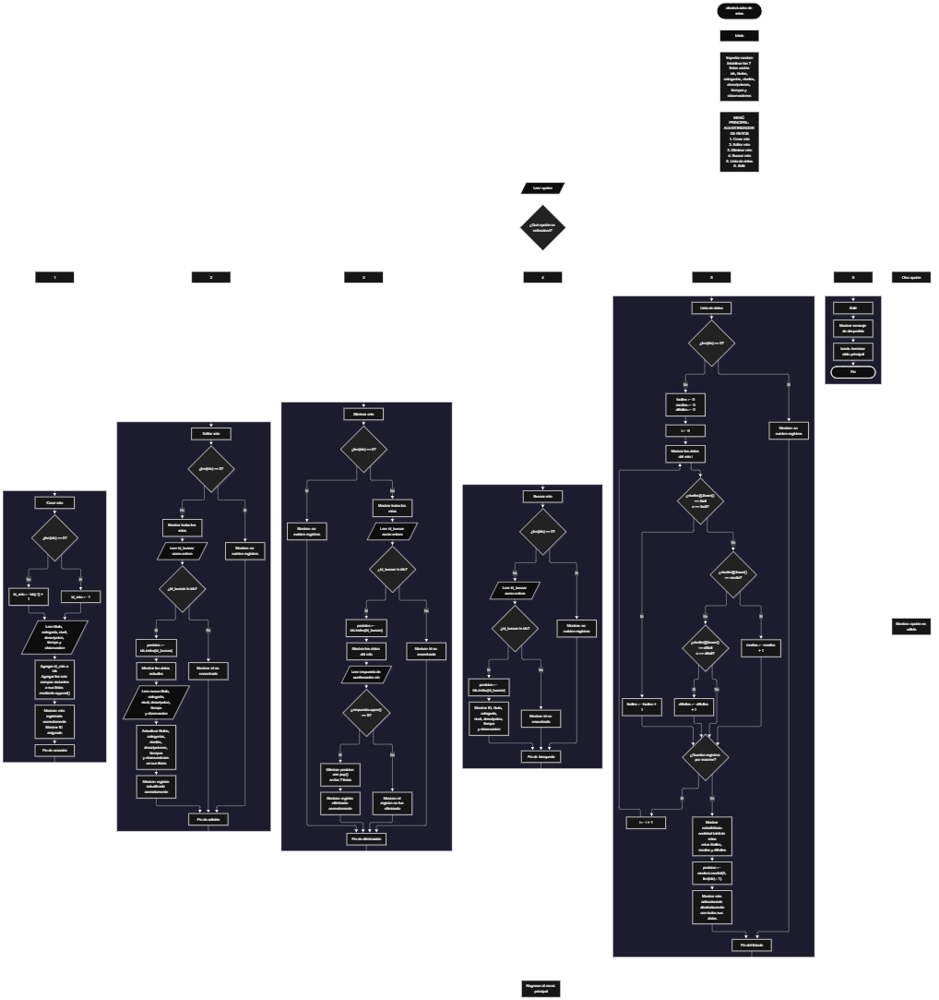

 

Este proyecto, llamado <b>aleatorizador de retos</b>, fue desarrollado en <b>python</b> como un ejercicio práctico para fortalecer la lógica de programación mediante la creación de un sistema de gestión y selección aleatoria de retos desde la consola. El programa cuenta con un menú principal de seis opciones que permite <b>crear, editar, eliminar, buscar y listar</b> los retos registrados, además de finalizar la ejecución. Cada reto almacena información como el título, la categoría, el nivel de dificultad, la descripción, el tiempo límite y las observaciones, utilizando siete listas paralelas para organizar los datos durante la ejecución. También incorpora estadísticas que contabilizan los retos fáciles, medios y difíciles, junto con un mecanismo que selecciona aleatoriamente uno de los retos registrados. Durante su desarrollo se aplicaron conceptos fundamentales de programación, como variables, listas, estructuras condicionales, ciclos repetitivos, búsqueda mediante identificadores, manipulación de registros y generación de valores aleatorios. Este proyecto permite poner en práctica los conocimientos adquiridos en python y sirve como base para desarrollar sistemas de gestión y selección de actividades más avanzados.

<h2 align="center">⚙️ Funcionamiento del menú principal</h2>

### ➕ Crear reto

La opción <b>1) crear reto</b> permite registrar un nuevo reto en el sistema. Antes de realizar el registro, el programa comprueba si la lista <b>ids</b> está vacía mediante la condición <b>len(ids) == 0</b>. Si no existen registros, asigna el identificador <b>1</b> a la variable <b>id_reto</b>. En caso contrario, obtiene el último identificador almacenado y le suma uno mediante la expresión <b>ids[-1] + 1</b>. Después, solicita el <b>título, la categoría, el nivel de dificultad, la descripción del reto, el tiempo límite y la observación</b>. Los datos se almacenan en sus respectivas listas mediante el método <b>append()</b>, manteniendo la misma posición para la información de cada reto. Finalmente, muestra el mensaje <b>"reto registrado correctamente."</b> y presenta el identificador asignado.

### ✏️ Editar reto

La opción <b>2) editar reto</b> permite modificar la información de un reto registrado. Primero, el programa comprueba si existen registros mediante la condición <b>len(ids) == 0</b>. Si las listas están vacías, muestra el mensaje <b>"no existen registros."</b>. En caso contrario, presenta todos los retos almacenados con sus respectivos identificadores y datos. Después, solicita el identificador del registro que se desea editar mediante la variable <b>id_buscar</b>, convirtiendo la entrada a un número entero con <b>int()</b>. Si el identificador se encuentra en la lista <b>ids</b>, utiliza <b>ids.index(id_buscar)</b> para obtener la posición correspondiente y mostrar los datos actuales. A continuación, solicita el nuevo título, categoría, nivel de dificultad, descripción, tiempo límite y observación, actualizando directamente los valores de las listas correspondientes. El identificador se conserva sin modificaciones. Finalmente, muestra el mensaje <b>"registro actualizado correctamente."</b>. Si el identificador no se encuentra, presenta el mensaje <b>"id no encontrada."</b>.

### 🗑️ Eliminar reto

La opción <b>3) eliminar reto</b> permite eliminar un reto registrado mediante su identificador. Primero, el programa comprueba si existen registros. Si no hay datos almacenados, muestra el mensaje <b>"no existen registros."</b>. Si existen retos, presenta una lista con sus identificadores y toda la información disponible. Después, solicita el identificador que se desea eliminar y comprueba si está presente en la lista <b>ids</b>. Cuando encuentra el registro, obtiene su posición mediante <b>ids.index(id_buscar)</b> y muestra sus datos antes de solicitar la confirmación mediante la pregunta <b>"¿desea eliminar este registro? (s/n):"</b>. Si la respuesta convertida a mayúsculas mediante <b>upper()</b> es igual a <b>"S"</b>, elimina la posición correspondiente de las siete listas utilizando el método <b>pop()</b>. De esta manera, se conserva la correspondencia entre los datos de los retos restantes. Finalmente, muestra el mensaje <b>"registro eliminado correctamente."</b>. Si la respuesta no es afirmativa, presenta el mensaje <b>"el registro no fue eliminado."</b>. Cuando el identificador no existe, muestra <b>"id no encontrada."</b>.

### 🔎 Buscar reto

La opción <b>4) buscar reto</b> permite localizar un reto específico mediante su identificador. Primero, el programa comprueba si existen registros almacenados. Si no hay ninguno, muestra el mensaje <b>"no existen registros."</b>. En caso contrario, solicita el identificador mediante la variable <b>id_buscar</b> y comprueba si está presente en la lista <b>ids</b>. Si encuentra una coincidencia, utiliza <b>ids.index(id_buscar)</b> para obtener la posición del registro y mostrar todos sus datos: identificador, título, categoría, nivel de dificultad, descripción, tiempo límite y observación. Si el identificador no se encuentra en la lista, muestra el mensaje <b>"id no encontrada."</b>. Esta operación permite consultar un reto individual sin necesidad de recorrer visualmente todos los registros.

### 📋 Lista de datos

La opción <b>5) lista de datos</b> permite visualizar los retos registrados, calcular estadísticas según su nivel de dificultad y seleccionar un reto aleatoriamente. Primero, el programa comprueba si existen registros. Si las listas están vacías, muestra el mensaje <b>"no existen registros."</b>. Si hay información disponible, inicializa los contadores <b>faciles, medios y dificiles</b> con el valor <b>0</b>. A continuación, utiliza un ciclo <b>for</b> para recorrer los registros y mostrar los datos de cada reto. Durante el recorrido, examina el contenido de la lista <b>niveles</b> y utiliza el método <b>lower()</b> para comparar los niveles sin distinguir entre mayúsculas y minúsculas. Los valores <b>"fácil"</b> y <b>"facil"</b> incrementan el contador <b>faciles</b>; el valor <b>"media"</b> incrementa <b>medios</b>; y los valores <b>"difícil"</b> y <b>"dificil"</b> incrementan <b>dificiles</b>. Al finalizar el recorrido, presenta la cantidad total de retos y las estadísticas de dificultad. Después, utiliza <b>random.randint(0, len(ids) - 1)</b> para generar una posición aleatoria válida dentro de las listas y mostrar todos los datos del reto seleccionado. De esta manera, la opción combina el listado, el análisis estadístico y la selección aleatoria en una sola operación.

### 🚪 Salir del menú principal

La opción <b>6) salir</b> permite finalizar la ejecución del programa. Cuando el usuario selecciona esta opción, se muestra el mensaje <b>"gracias por utilizar el aleatorizador de retos."</b> y se ejecuta la instrucción <b>break</b>, que interrumpe el ciclo <b>while True</b> del menú principal. A diferencia de las demás opciones, esta operación no modifica ni consulta los registros, sino que finaliza la interacción con el sistema. Los datos almacenados en las listas se mantienen únicamente durante la ejecución del programa y no se guardan de manera permanente.

<h2 align="center">🧠 Temas aplicados en el proyecto</h2>

### 📦 Variables

En este proyecto se utilizan variables para almacenar temporalmente los datos de cada reto, controlar la opción seleccionada en el menú, asignar identificadores, localizar registros y calcular estadísticas. También se emplean variables para controlar la posición de un registro dentro de las listas y almacenar la respuesta de confirmación durante la eliminación. Cada variable cumple una función específica dentro de las operaciones de gestión y consulta.

🔢 <b>opcion:</b> Almacena la opción seleccionada por el usuario en el menú principal.

🆔 <b>id_reto:</b> Almacena el identificador asignado al nuevo reto.

🔎 <b>id_buscar:</b> Guarda el identificador introducido para localizar un registro durante las operaciones de edición, eliminación y búsqueda.

📍 <b>posicion:</b> Almacena el índice del reto encontrado y también se utiliza para seleccionar el reto aleatorio.

📝 <b>titulo, categoria, nivel, descripcion, tiempo y observacion:</b> Almacenan temporalmente los datos introducidos durante la creación de un reto.

🔄 <b>i:</b> Funciona como contador en el ciclo que recorre los registros durante el listado.

📊 <b>faciles, medios y dificiles:</b> Acumulan la cantidad de retos clasificados en cada nivel de dificultad reconocido.

✅ <b>respuesta:</b> Almacena la respuesta del usuario para determinar si confirma la eliminación de un reto.

### 🗃️ Listas

El programa utiliza siete listas paralelas para almacenar la información de los retos. Cada lista contiene un tipo de dato correspondiente a los registros y utiliza la misma posición para relacionar la información de un mismo reto. Por ejemplo, los datos de un registro ubicado en la posición <b>0</b> se distribuyen entre <b>ids[0], titulos[0], categorias[0], niveles[0], descripciones[0], tiempos[0] y observaciones[0]</b>. Esta organización facilita agregar, consultar, actualizar y eliminar registros manteniendo la correspondencia entre sus campos.

🆔 <b>ids:</b> Almacena los identificadores numéricos de los retos.

📝 <b>titulos:</b> Almacena los títulos de los retos.

🗂️ <b>categorias:</b> Almacena las categorías de los retos.

🎚️ <b>niveles:</b> Almacena los niveles de dificultad.

📄 <b>descripciones:</b> Almacena las descripciones de los retos.

⏱️ <b>tiempos:</b> Almacena los tiempos límite introducidos para los retos.

📌 <b>observaciones:</b> Almacena las observaciones adicionales de cada reto.

### 🔀 Estructuras condicionales

En este proyecto se utilizan las estructuras <b>if, elif y else</b> para controlar el comportamiento del menú y decidir qué instrucciones deben ejecutarse según las condiciones encontradas. Estas estructuras permiten comprobar si existen registros, determinar el identificador que se asignará a un nuevo reto, verificar si un identificador está registrado, decidir si se confirma una eliminación y clasificar los retos según su dificultad. También permiten mostrar un mensaje cuando el usuario introduce una opción que no está contemplada en el menú.

### 🔄 Estructuras repetitivas

El programa utiliza el ciclo <b>while True</b> para mantener activo el menú principal hasta que el usuario selecciona la opción de salida, que ejecuta <b>break</b>. También emplea ciclos <b>for</b> para recorrer las listas y mostrar los registros durante las operaciones de edición, eliminación y listado. En la opción de estadísticas, el ciclo permite examinar el nivel de dificultad de cada reto y actualizar los contadores correspondientes. Estas estructuras facilitan repetir las operaciones y procesar todos los registros almacenados.

### 🎯 Selección de opciones

La selección de operaciones se realiza mediante una estructura condicional compuesta por <b>if, elif y else</b>. La variable <b>opcion</b> recibe el valor introducido por el usuario como una cadena de texto y se compara con los valores <b>"1", "2", "3", "4", "5" y "6"</b>. Cada comparación dirige la ejecución hacia una funcionalidad específica. Si el valor no coincide con ninguna opción definida, se muestra el mensaje <b>"opción no válida."</b>.

### 🔍 Búsqueda mediante identificadores

El programa utiliza la lista <b>ids</b> para localizar los registros mediante sus identificadores. La expresión <b>id_buscar in ids</b> comprueba si el identificador existe, mientras que <b>ids.index(id_buscar)</b> obtiene la posición del elemento encontrado. Esta posición permite acceder a los datos relacionados en las otras seis listas, ya que todas mantienen la misma organización. Este mecanismo se aplica durante las operaciones de edición, eliminación y búsqueda.

### 🧮 Estadísticas y contadores

La opción de listado incorpora contadores para calcular la cantidad de retos fáciles, medios y difíciles. Antes de recorrer los registros, las variables <b>faciles, medios y dificiles</b> se inicializan en cero. Después, el programa compara el nivel de cada reto con los valores reconocidos y aumenta el contador correspondiente. Al terminar el recorrido, presenta la cantidad total de registros mediante <b>len(ids)</b> y muestra los resultados de cada contador. Las estadísticas dependen de los textos introducidos en el campo de nivel de dificultad.

### 🎲 Selección aleatoria

El programa importa el módulo <b>random</b> para seleccionar un reto al azar. Después de mostrar el listado y las estadísticas, utiliza la función <b>random.randint(0, len(ids) - 1)</b> para generar un índice comprendido entre la primera posición válida y la última posición ocupada. El índice generado se almacena en la variable <b>posicion</b> y permite mostrar los datos del reto seleccionado. Esta operación solo se ejecuta cuando existen registros, evitando intentar seleccionar elementos de listas vacías.

### 🔤 Manipulación de cadenas

El programa utiliza los métodos <b>upper()</b> y <b>lower()</b> para facilitar las comparaciones de texto. El método <b>upper()</b> convierte la respuesta de confirmación a mayúsculas, de modo que la letra <b>"s"</b> también se reconoce como <b>"S"</b> durante la eliminación. Por otro lado, <b>lower()</b> convierte los niveles de dificultad a minúsculas antes de compararlos, permitiendo reconocer las variantes contempladas sin distinguir entre letras mayúsculas y minúsculas.

<h2 align="center">¿Cómo se implementaron las operaciones crud en el proyecto?</h2>

Las operaciones <b>crud</b> se implementaron mediante las opciones del menú principal para administrar los retos almacenados en las listas. La operación <b>crear</b> corresponde a <b>crear reto</b>, donde se solicitan los datos y se agregan a las siete listas; <b>leer</b> se realiza mediante las opciones <b>buscar reto y lista de datos</b>, que permiten consultar un registro específico o visualizar todos los registros junto con sus estadísticas y la selección aleatoria; <b>actualizar</b> corresponde a <b>editar reto</b>, donde se modifican los campos descriptivos de un registro sin cambiar su identificador; y <b>eliminar</b> se realiza mediante la opción <b>eliminar reto</b>, que solicita confirmación antes de retirar los datos de las listas. Estas operaciones se apoyan en variables, condicionales, ciclos y métodos de listas para administrar la información durante la ejecución del programa.

<h2 align="center">Diagrama de flujo del proyecto</h2>

<h2 align="center">🛡️ Validaciones del programa</h2>

### 📭 No existen registros

Esta comprobación se utiliza en las opciones de <b>editar, eliminar, buscar y lista de datos</b>. El programa evalúa la condición <b>len(ids) == 0</b> para determinar si existen retos almacenados. Si las listas están vacías, muestra el mensaje <b>"no existen registros."</b> y evita continuar con las operaciones que necesitan datos existentes. En la opción de creación, esta misma condición se utiliza para asignar el identificador inicial <b>1</b>.

### 🔎 Identificador no encontrado

Esta comprobación se utiliza durante las operaciones de edición, eliminación y búsqueda. El programa verifica si el identificador introducido mediante <b>id_buscar</b> está presente en la lista <b>ids</b>. Si no existe, muestra el mensaje <b>"id no encontrada."</b>. Cuando el identificador es válido, obtiene su posición mediante <b>ids.index(id_buscar)</b> para acceder a los datos relacionados con el registro.

### 🗑️ Confirmación de eliminación

Antes de eliminar un reto, el programa solicita una confirmación al usuario. La condición <b>respuesta.upper() == "S"</b> determina si se ejecuta la eliminación. Si se cumple, se retiran los elementos de la posición seleccionada en las siete listas mediante <b>pop()</b>. Si la respuesta es diferente de <b>"S"</b>, el registro se conserva y se muestra el mensaje <b>"el registro no fue eliminado."</b>.

### 🎚️ Clasificación de la dificultad

Durante el cálculo de las estadísticas, el programa compara los valores de la lista <b>niveles</b> con los textos reconocidos para cada dificultad. Se aceptan <b>"fácil"</b> y <b>"facil"</b> para los retos fáciles, <b>"media"</b> para los retos medios, y <b>"difícil"</b> y <b>"dificil"</b> para los retos difíciles. Sin embargo, el programa no valida estos valores al crear o editar un reto. Si se introduce un nivel diferente, el registro se muestra normalmente, pero no incrementa ninguno de los tres contadores.

### 🎲 Selección aleatoria con registros disponibles

La selección aleatoria se ejecuta dentro de la opción <b>5) lista de datos</b>, después de comprobar que existen registros. El programa genera una posición entre <b>0</b> y <b>len(ids) - 1</b> mediante <b>random.randint()</b>. Esta condición de entrada evita que se intente elegir un reto cuando las listas están vacías.

### ⚠️ Limitaciones de entrada y almacenamiento

El programa no valida que los campos introducidos contengan información, por lo que permite registrar o editar retos con campos vacíos. Además, las entradas de identificadores se convierten mediante <b>int()</b>; si el usuario introduce un texto que no puede convertirse a entero, puede producirse un error. El sistema tampoco limita la cantidad de registros ni valida el formato del tiempo límite. Finalmente, los datos se almacenan únicamente en listas durante la ejecución, sin utilizar archivos o una base de datos para conservarlos al cerrar el programa. Asimismo, el identificador se calcula a partir del último elemento de <b>ids</b>, por lo que puede reutilizarse si se elimina el último registro y posteriormente se crea otro.

<h2 align="center">🎯 Objetivo del proyecto</h2>

El objetivo principal de este proyecto es fortalecer la <b>lógica de programación</b> mediante el desarrollo de un sistema de gestión y selección aleatoria de retos en <b>python</b>. A través de su construcción se busca aplicar los conocimientos adquiridos sobre variables, listas, estructuras condicionales, ciclos repetitivos, búsqueda mediante identificadores, manipulación de registros y generación de valores aleatorios. Además, el proyecto permite comprender cómo crear, consultar, modificar y eliminar información, calcular estadísticas según una clasificación determinada y seleccionar elementos de manera aleatoria. De esta forma, constituye una base práctica para desarrollar aplicaciones de consola más completas y ampliar posteriormente sus funcionalidades.

